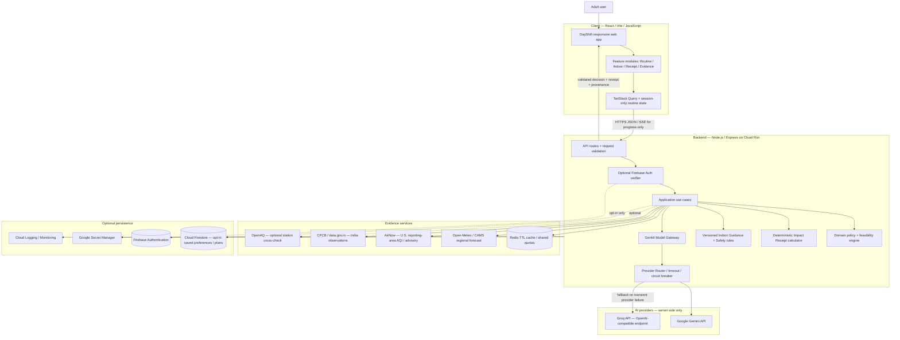
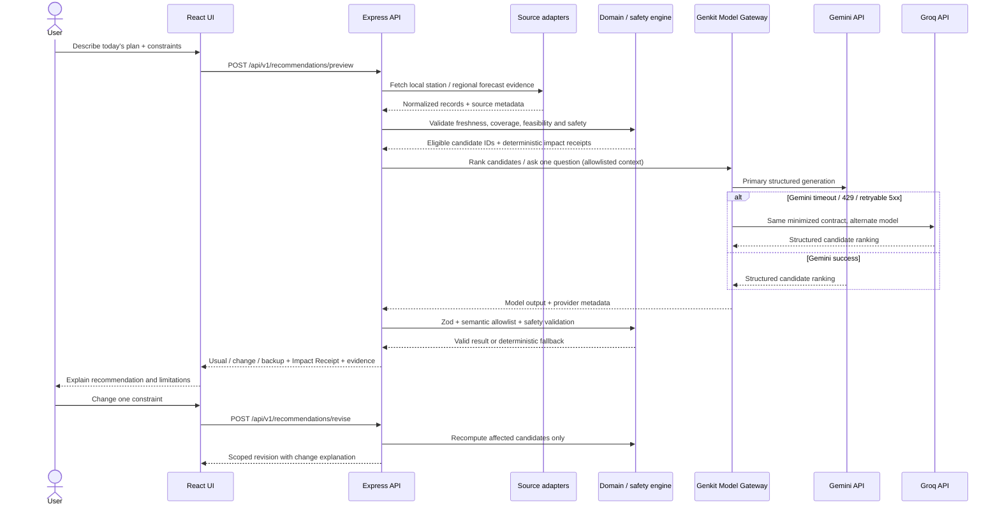

# DayShift — Product, Architecture & Engineering Design

**Project:** DayShift — Urban Air Quality Assistant  
**Challenge:** PromptWars / Hack2Skill Challenge 6  
**Document status:** Build specification for the hackathon MVP  
**Research baseline:** Combined user-provided research + Challenge 5 (Trellis) evaluator report + official source checks accessed 20 November 2026.

---

## 1. Executive decision

DayShift is a **constraint-aware daily routine planner for cleaner-air choices**. It is not primarily an AQI dashboard, a generic chatbot, a route map, or a health app.

Its defining question is:

> **“Here’s what I need to do today. What’s one realistic change I can make, what would it actually improve, and what should I do if conditions change?”**

The product takes a user's existing plan and compares:

1. **Usual plan** — the baseline, preserving the user's stated constraints.
2. **One recommended change** — the highest-value feasible adjustment supported by available evidence.
3. **Backup plan** — a practical alternative if the first change is impossible or the data/conditions change.

Every proposed change receives an **Impact Receipt** with three independent channels:

- **Outdoor air context:** pollutant, time window, source/model, geographic coverage and what can/cannot be inferred.
- **Indoor air action:** the source-control, ventilation or filtration mechanism and the conditions under which it is appropriate.
- **Emissions:** a bounded estimate versus a stated baseline only when a suitable region-, activity- and factor-specific source is available.

These channels are never collapsed into a composite “clean air score”. A lower-carbon choice does not automatically mean lower personal exposure. Ambient concentration is not an individual's inhaled dose. A city-scale forecast is not a street-level sensor reading.

### Product promise

**DayShift helps people make one practical, evidence-aware change to their day without demanding continuous tracking, expensive equipment, or a complete lifestyle redesign.**

### Why this is differentiated

AirNow and other AQI products already provide readings, forecasts, maps and advisories. Cleaner-route products already promote route and activity timing. DayShift's differentiator is not “we have AI” or “we show a map”. It is the **constraint-aware comparison loop**:

- understand what the user actually needs to do;
- ask only the question that could change the recommendation;
- retrieve source-labelled evidence;
- remove infeasible choices before AI ranking;
- let Gemini/Groq rank and explain only the eligible choices;
- calculate impacts deterministically;
- show what is known, estimated and unknown;
- update only the affected decision when a constraint changes.

The main demo should make this visible in one journey.

---

## 2. What to carry forward from Trellis

The user reported an overall Trellis score of **96.6**. The uploaded code evaluator report separately records **95.25/100 weighted code score (9.53/10 normalized)**. The report does not explain how 96.6 was calculated, so these figures should not be treated as the same metric.

| Trellis parameter | Reported score | Weight | What DayShift should preserve or improve |
|---|---:|---:|---|
| Problem statement alignment | 100 | 30% | Preserve complete end-to-end traceability from every brief clause to a working interface, use case and test. |
| Code quality | 95 | 20% | Preserve layered architecture, domain isolation, dependency injection, clear contracts; split frontend API clients by feature and document non-obvious UI behavior. |
| Security | 100 | 15% | Preserve server-side authorization, deny-by-default access, secret management and rate limiting; add location, routine and model-payload privacy tests. |
| Efficiency | 85 | 15% | Fix the biggest gap: shared/centralized quotas, bounded caches, in-flight request coalescing, load tests and measured latency/failure evidence. |
| Testing | 100 | 10% | Preserve broad testing; add source freshness, pollutant/unit correctness, impact-factor boundaries, safety invariants, provider failover and privacy-retention tests. |
| Accessibility | 85 | 10% | Prove keyboard operation, dialog focus behavior, contrast ratios, responsive reflow and screen-reader alternatives—not just ARIA attributes. |

**Key lesson:** Efficiency and accessibility accounted for 3.75 of the 4.75 weighted code-score points left on the table in the Trellis report. Spend more time proving these two areas instead of chasing optional features. Challenge 6's actual scoring weights are not confirmed; the Trellis weights are a planning baseline, not a scoring prediction.

### Keep / improve / avoid

**Keep:** pnpm monorepo; clean architecture; pure domain functions; Zod contracts; injected ports/adapters; structured GenAI output; provider fallback; server-only secrets; meaningful tests; real end-to-end paths; no fake vendor/AI facades.

**Improve:** feature-owned frontend API modules; JSDoc for public and non-obvious logic; shared quota/rate-limit storage; bounded TTL caches; explicit source and model metadata; keyboard-only E2E tests; documented contrast checks; measurable performance report; source/forecast-specific correctness tests.

**Avoid:** a monolithic API client; process-local unbounded maps for production limits; generating plans before the app has real evidence; treating mock fixtures as live data; hardcoded AQI readings; made-up emission factors; a full-screen chatbot as the product; continuous GPS by default; route maps before the primary routine loop works; multi-agent orchestration, vector databases or MCP added without a justified requirement.

---

## 3. Target users and MVP segment

### Primary MVP audience

Start with **adults who have fixed urban routines and limited flexibility**. Two user groups are especially useful together:

1. **Urban commuters:** people who travel to work or college and can sometimes combine errands, choose a mode, change a departure window, or adjust where they wait.
2. **Renters / household organizers:** adults who cook and manage indoor air but have limited control over building systems, may not own an air purifier, and may not have an indoor monitor.

These users cover the outdoor routine, sustainable alternative and indoor-air parts of the brief while keeping the initial product narrow.

### Secondary users

- Adults who schedule outdoor exercise and need an indoor or alternate-time backup.
- Adult caregivers coordinating household errands without disclosing family diagnoses.
- Later: schools, employers, community groups and local non-profits using aggregated, privacy-protected guidance.

### User jobs and constraints

| User | Job to be done | Constraints DayShift must respect |
|---|---|---|
| Fixed-shift commuter | “Help me make my commute or errands less polluting without arriving late.” | Arrival deadline, available mode, budget, physical accessibility, number of trips, errands. |
| Renter / household organizer | “What can I do about cooking smoke or outdoor pollution without buying equipment?” | No control over building systems, ventilation options, budget, no sensor. |
| Outdoor exerciser | “Can I move this activity to a better-supported time, or what is my practical indoor backup?” | Schedule, activity, weather/heat, forecast resolution and uncertainty. |
| Adult caregiver | “Help me adapt a shared day without exposing family health details.” | Care windows, privacy, limited flexibility and no requirement to share diagnoses. |

### Out of scope for MVP

- Direct AI accounts for children or child health profiles.
- Diagnosing, screening or predicting personal medical outcomes.
- Background GPS tracking, passive commute surveillance or wearable integration.
- Public health emergency monitoring or official emergency alert replacement.
- Citywide pollution control claims, street-level precision without data, or unverified crowd reports.
- Enterprise/school fleet optimization, social leaderboards and sensor marketplace.

Do not ask users for asthma, pregnancy, medication, children's details or other diagnoses. A general optional preference such as **“show more cautious outdoor options”** may be offered without asking why.

---

## 4. Signature capabilities — prioritize depth, not feature count

### P0. Routine Decision Board (the product's hero)

The user begins with a task, not a long profile form. Three entry points:

- **Plan a trip or commute**
- **Choose an outdoor activity time**
- **Improve indoor air**

The user enters a city manually and describes a simple routine. DayShift preserves hard constraints such as “must arrive by 9:00”, “transit is not practical”, “cannot leave earlier”, “no outdoor-vented hood” and “must keep costs low”.

The output is always structured as **Usual plan / One change / Backup**. The recommended change must be feasible, small and evidence-supported. If no defensible alternative exists, DayShift says so and suggests a non-time-based action instead of inventing a better time.

### P0. Impact Receipt (the signature explanation)

For every recommended option, answer:

1. Compared with what baseline?
2. What exactly changes?
3. What source, model, formula or reviewed guidance supports it?
4. What assumptions were needed?
5. What is not known?

**Outdoor air context** can report a forecast window, pollutant trend or a data-supported comparison. Without route-level concentrations and personal ventilation inputs, do not claim personal inhaled dose or a percentage reduction in exposure.

**Indoor air** explains a mechanism (source control, exhaust to outdoors, filtered ventilation, portable filtration) and prerequisites. Do not report an indoor AQI or percentage improvement without a suitable indoor sensor/intervention measurement.

**Emissions** use a versioned factor and a matching region/activity/fuel/boundary. Label the result as an estimate, e.g. “estimated tailpipe CO₂ avoided”, not a measured saving or lifecycle impact. If no relevant factor is available, display “not estimated” rather than zero.

### P0. Adaptive Constraint Replanner

The user can say:

- “I cannot leave earlier.”
- “Transit isn't available for me.”
- “I need to pick up groceries.”
- “I don't have a kitchen hood that vents outdoors.”
- “The forecast has changed.”

The assistant asks one high-value follow-up if required, rebuilds only the affected candidates, shows the change and why, and preserves all unrelated choices. It never silently assumes a bus timetable, route, vehicle, source reading or household device.

### P0. Indoor Action Coach (no-purchase first)

Use a reviewed, versioned guidance library, selected by a rules engine. Examples:

- cooking: use an outdoor-vented hood while cooking when one exists; explain source capture;
- avoid or reduce unnecessary indoor particle sources such as burning incense/candles or high-smoke cooking during an episode;
- do not automatically advise opening windows when outdoor smoke/PM is high;
- distinguish ventilation (dilution/removal of indoor-generated contaminants when outdoor air is suitable) from filtration (particle removal; not a universal gas solution);
- filtration can supplement source control and appropriate ventilation, not replace all other measures;
- consider heat safety: do not advise staying in an overheated room simply to avoid outdoor pollution;
- if a carbon monoxide alarm activates, interrupt the planning flow and show reviewed local emergency instructions immediately.

The LLM may explain reviewed guidance in simpler language. It must not invent new “air-cleaning hacks”.

### P0. Evidence & freshness layer

Every data point includes provider, dataset kind, pollutant/index, unit, area/grid coverage, station/model identifier, valid time, retrieval time, model issue time where available, quality flags and attribution. A fresh HTTP response can still contain a forecast issued earlier; show both fetch and valid times where available.

### P1. Save coarse routine / action feedback

Only after core flow is working: users may explicitly save a coarse routine preset or confirm they took an action. Keep projected impact separate from user-reported completion. Do not use completion feedback to claim measured pollution reduction.

### Defer

Street-level routing, background tracking, push alerts, hardware sensor ingestion, community reports, social challenges, leaderboards, and multi-activity carbon totals. These introduce data, safety, privacy or scientific complexity before the central decision loop is proven.

---

## 5. Scientific and impact model

### Keep these concepts separate

- **Ambient concentration:** pollutant concentration in outdoor air, e.g. PM₂.₅ in µg/m³.
- **AQI:** a jurisdiction-specific communication index derived using its own averaging windows and breakpoints. It is not a universal pollutant unit.
- **Forecast/model estimate:** a spatially gridded model output, not a station measurement.
- **Station observation:** measurement from a specific monitoring site, potentially preliminary and not necessarily representative of the user's exact block.
- **Indoor air:** not known from an outdoor station or outdoor forecast.
- **Personal exposure / inhaled dose:** depends on concentration over the actual path and time, breathing rate, activity intensity, indoor infiltration, and other factors. City-level AQI alone cannot calculate an individual's inhaled dose.
- **Emissions:** mass emitted by an activity/vehicle under a defined factor boundary. This is distinct from ambient concentration and personal exposure.

### Pollutants to model where sources support them

PM₂.₅, PM₁₀, NO₂, O₃, SO₂ and CO are the initial pollutant set. Preserve native units from each provider. Do not silently convert gas units or apply one region's AQI breakpoints to another region.

### AQI rules

- India: apply CPCB National AQI rules only when using appropriate CPCB data/inputs and averaging conventions.
- United States: use AirNow's delivered AQI and reporting-area categories for the public-facing U.S. slice; disseminate advisories unchanged and attribute to issuing agencies/AirNow.
- CAMS/Open-Meteo: use raw pollutant forecast values as primary model evidence; if displaying an Open-Meteo-derived index, label its standard explicitly (e.g. European AQI or U.S. AQI) and never call it a CPCB AQI or official AirNow value.
- Never compare two different AQI scales numerically as though they were equivalent.

### What can be computed

**Outdoor comparison:** If two schedule windows have comparable forecast values from the same provider/grid, pollutant and unit, DayShift may show a relative area-level forecast comparison such as “the model indicates lower PM₂.₅ during the later window in this grid cell.” This is not a personal dose estimate and may be too coarse to support a recommendation if windows are nearly tied.

**Simple exposure proxy:** A calculation such as concentration × time can be used as a labelled scenario proxy only when the same location/time basis and relevant activity duration are available. It is not inhaled dose and must not be named “dose” or translated into health-risk reduction.

**Emissions:**

`estimated_avoided_emissions = max(0, baseline_activity_units - alternative_activity_units) × versioned_emission_factor`

Each factor must record: region, activity/vehicle class, fuel or energy type, unit basis, tailpipe vs lifecycle boundary, source URL, publication/vintage, date verified and uncertainty. If one side of the comparison is missing, do not estimate. The EPA's U.S. passenger-vehicle factor must not be used as an India-specific factor. A bus passenger-km factor must not be confused with vehicle-km, or treated as the marginal emissions caused by one extra passenger.

### Never calculate or claim

- “AQI saved” as a personal health benefit.
- “20% lower AQI = 20% less pollution inhaled.”
- Individual lung/heart risk, disease probability, diagnosis or lifetime risk.
- “The city AQI fell because of your action.”
- Indoor AQI or room-safety claims without appropriate indoor measurement.
- Precise route-level exposure from an 11 km or 45 km grid.
- Emissions values from a factor applied outside its region, vehicle class or calculation boundary.

---

## 6. Data source strategy and provider responsibilities

### Core strategy

DayShift's first market is India (with a likely Tamil Nadu / Coimbatore demo), while supporting a U.S. source path. **Open-Meteo/CAMS provides regional forecasts; AirNow provides the U.S. reporting-area AQI/forecast/advisory path.** Neither replaces the relevant official India source.

| Provider | DayShift role | What it supports | Important limitations / rules | MVP decision |
|---|---|---|---|---|
| **Open-Meteo Air Quality API / CAMS** | Regional model forecasts, pollutant trends and weather context | Hourly/3-hourly model forecast variables for PM₂.₅, PM₁₀, NO₂, O₃, SO₂, CO etc.; weather API can supply temperature, wind, precipitation and humidity | CAMS European forecast is roughly 0.1° / 11 km, hourly, 4 days, refreshed about daily; CAMS global forecast is roughly 0.4° / 45 km, 3-hourly, 5 days, refreshed about every 12 hours. India generally uses the **global** grid, not the European 11 km grid. Forecast grid center may be kilometres away from requested coordinates. Free API is non-commercial and has request limits; data is CC BY 4.0 and attribution to Open-Meteo and CAMS is required. | **P0 global forecast adapter.** Use global CAMS for India; label 45 km / 3-hourly and never imply hyperlocal precision. Check license for demo/commercial use. |
| **AirNow API** | U.S. public-facing AQI observations, forecasts, action days/advisories | Current AQI by reporting area, lat/long or ZIP; forecasts by reporting area; observations by monitoring site/geographic range; PM₂.₅/O₃ contour products | U.S.-specific reporting areas; reporting areas vary in size and forecast coverage. API key required. AirNow FAQ describes observations generally hourly and forecasts daily and recommends hourly/daily caching; limits are per service and cannot be increased. Observations are preliminary and can change; they are not final regulatory AQS data. Do not alter source forecast/advisory wording or values; attribute issuing agencies and AirNow. | **P0 U.S. adapter.** Only use when location resolves to U.S. reporting area. For regulatory-quality analysis, EPA AQS is the separate validated source. |
| **CPCB / data.gov.in Real-time Air Quality Index** | India station observations and official India AQI context | Station-wise air-quality data across India; catalog describes hourly granularity and pollutants including PM₂.₅, PM₁₀, NO₂, SO₂, CO and O₃ | Catalog's latest surfaced update was 22 May 2026; raw field-instrument data are displayed without human intervention and can contain instrument errors or abnormal values. Station coverage is uneven. Confirm endpoint, API key, terms and per-resource limits at implementation time. Do not claim all Indian cities have nearby stations. | **P0 India path.** Fetch the official catalog/resource; display station name/distance, timestamp and quality caveat. If coverage is absent, fall back to CAMS regional forecast, clearly labelled model data. |
| **OpenAQ** | Optional station discovery/corroboration and later historical comparison | Aggregated ground monitoring data with source provenance | Coverage, timeliness, provider licensing and quality vary by station and sensor. Not a forecast; not automatically an official regulatory AQI. Verify OpenAQ API plan/rate limits and each source's metadata. | **P1/optional.** Do not block core demo on it. Do not silently merge into CPCB/AirNow readings. |
| **Reviewed indoor guidance library** | Indoor recommendations and safety policy | Source-control, ventilation and filtration guidance selected by situation | Guidance is not an indoor reading. Keep source, revision date, applicable conditions, contraindications and locale in content records. | **P0.** Curated, versioned content, not model-invented advice. |

### Provider routing rules

1. Resolve country/region from the user-selected city or region (no GPS required).
2. **India:** retrieve CPCB observations where a usable nearby station exists; retrieve Open-Meteo/CAMS global forecast for regional context. Optionally compare OpenAQ station data later.
3. **United States:** retrieve AirNow current reporting-area AQI and forecasts/advisories. Use Open-Meteo/CAMS as a separate model forecast only if the UI labels it as model output and does not conflate its index with AirNow.
4. **Other regions:** Open-Meteo/CAMS global forecast can support broad planning. Do not apply CPCB or AirNow categories/health rules. Local official datasets can be added as adapters after verification.
5. If station and model disagree, show them as separate evidence types; do not average them into a synthetic “truth”.
6. If a source fails, show last-known data with valid/retrieved timestamps and stale label only if the source's terms permit caching. Otherwise show unavailable.
7. Never state “current AQI” when only a forecast or stale model output exists. Use precise labels: “station observation”, “model forecast”, “official reporting-area AQI”, “last updated”.

---

## 7. Privacy and safety by design

### Privacy-first default

- Manual city/area selection is the default. No browser geolocation prompt is needed for the first run.
- Do not ask for a home or work address. Do not store exact coordinates or precise daily itineraries.
- Routines and preferences remain in session state by default; save only after a clear opt-in.
- No login is required for the core journey. Add Firebase Auth only if the user opts to save routines across devices.
- No health diagnoses, medications, children’s health details, contacts, calendars, or wearable data.
- Send the LLM only a minimum, allowlisted context: city/region label, broad time window, activity type, constraints, eligible candidate IDs, and public evidence summaries. Do not send user IDs, exact endpoints, precise coordinates, credentials or hidden internal logs.
- Do not log raw prompts, location strings, exact schedules or indoor readings. Log request ID, provider, model, latency, token counts, status/error class, cache status and policy version.
- Provide review, delete and export controls if saved preferences are introduced. Define retention explicitly; do not retain a routine just because it was used once.

### Data classes and handling

| Data class | Default | Protection |
|---|---|---|
| City / coarse area | Needed for a query; not persisted by default | Normalize to public place/area ID or coarse grid; short-lived cache key; redact request logs. |
| Routine / commute constraints | Session-only | Minimize time precision; no addresses; do not use as analytics dimension. |
| Indoor equipment/context | Optional and coarse (e.g. vented hood: yes/no/unknown) | Session-only unless user explicitly saves; do not infer wealth/health. |
| Health-sensitive preference | Do not ask diagnosis; optional “more cautious choices” only | Never require explanation; do not send identifiable health text to an LLM. |
| Public AQ evidence | Cache according to source terms | Preserve source, units, timestamps, provenance and quality labels. |
| Account identifier | Only for optional saved plans | Firebase Auth; per-user authorization; least privilege; deletion workflow. |
| Provider API secrets | Server only | Secret Manager; never expose through Vite `VITE_*` variables or logs. |

### Security controls

- HTTPS only; strict CORS allowlist; Helmet/security headers; input size limits; schema validation and normalization.
- Server-side authorization for every private resource access; deny-by-default. Firebase Admin SDK bypasses client Firestore security rules, so API authorization must be explicit.
- Firestore client writes restricted to explicitly permitted user-owned data; server-owned evidence, plan snapshots and provider records are not client-writable.
- Secrets in Google Secret Manager; Cloud Run service identity with least-privilege IAM.
- Centralized quota/rate limiting via a shared TTL store (Redis-backed for hosted replicas). A bounded in-memory implementation is permitted only for local tests/single-process development and must be clearly marked.
- Per-user/anonymous-session and global cost limits; request budget caps; upstream timeout; bounded retries; circuit breakers.
- Prompt injection defense: treat provider responses, source text and user input as untrusted data. Retrieved content cannot issue instructions to the model or authorize tools. No model has database, secret-store or direct network tool access.
- Data minimization across both Gemini and Groq; provider failover must not silently expand the payload.
- **Provider data-use review:** Google's Gemini Developer API pricing page states that Free Tier content may be used to improve Google products, while Paid Tier content is not used for that purpose. Do not send personal/sensitive user routines to the unpaid tier; use synthetic/nonpersonal hackathon scenarios there. Re-check current terms and regional conditions before launch.
- **Groq data controls:** Groq states inference inputs/outputs are not retained by default, but limited retention can occur for reliability/abuse investigations (documented up to 30 days); Zero Data Retention is an account control with feature trade-offs. Groq also documents U.S.-located storage for retained customer data. Treat this as a processor/data-transfer decision, not as a reason to send exact itineraries or personal data.

### India privacy/regulatory note

The Digital Personal Data Protection Act, 2023 and Digital Personal Data Protection Rules, 2025 have been notified with phased commencement. As of 20 November 2026, the commencement schedule means some provisions have started while a number of substantive provisions are scheduled for the 18-month stage (around May 2027, subject to the exact notified clause and commencement date). DayShift should implement clear notice, purpose limitation, consent where required, user rights processes, security safeguards, retention/deletion and processor/vendor review from the beginning. Do not claim legal compliance solely because the product has a consent screen; verify the specific provision and commencement date on the launch date and obtain legal review before public deployment. Children should not be a direct target user for this MVP.

---

## 8. GenAI design — Gemini primary, Groq fallback

### Correct separation of responsibilities

**GenAI handles:**
- interpreting free-text intent into a structured request;
- selecting whether one missing detail materially affects the outcome;
- ranking already-eligible candidate options against user constraints;
- explaining trade-offs in plain language;
- adapting explanation language (English/Tamil later) and reframing choices when a constraint changes.

**Deterministic software handles:**
- source retrieval, geographic applicability, freshness, unit normalization and quality status;
- AQI standard/label logic; time-zone conversion;
- eligibility and hard-constraint filtering;
- all exposure proxy and emissions arithmetic;
- indoor safety gates and emergency interruption;
- evidence ownership and source attribution;
- authorization, privacy, quotas, caching, persistence and versioning;
- schema validation and semantic validation of AI output.

### Dual-provider setup

Use **Firebase Genkit** as the common orchestration interface. Configure:

- Google Gemini with `@genkit-ai/google-genai`.
- Groq using Genkit's generic OpenAI-compatible provider plugin `@genkit-ai/compat-oai` with Groq's base URL `https://api.groq.com/openai/v1`.

This is not a claim that Genkit ships a first-party Groq-specific plugin. Groq's API is OpenAI-compatible, and Genkit documents a general plugin for compatible endpoints.

**Primary:** Gemini Flash model selected from the current Gemini Developer API catalog. Keep the model ID configurable (`GEMINI_MODEL`). The current docs list stable models including `gemini-3.6-flash` and a dynamically resolving `gemini-flash-latest` alias; verify availability and structured-output support in the actual API project before pinning a release. Do not copy old Gemini 2.5/2.x names from older research.

**Fallback:** Groq model selected from its live supported-model list. A current production candidate is `openai/gpt-oss-120b`; `openai/gpt-oss-20b` may be a quicker/cost-conscious alternative. Groq documents strict JSON Schema outputs for selected models including both GPT-OSS models. Validate actual account limits and model availability at implementation time.

### Important correction about “more tokens”

Gemini and Groq have **separate** model context windows, per-minute quotas, daily quotas and account/plan limits. Groq does not merge with or increase Gemini's token quota. The second provider gives DayShift an independent capacity path when the first provider is temporarily unavailable, rate-limited or overloaded—subject to Groq's own limits and billing. If a prompt is too large for Gemini, it must be reduced/compacted or routed only if the fallback model's own context limit can accommodate it. Do not use failover to circumvent provider policies or quotas.

### Failover policy

1. Call Gemini first.
2. On transient timeout, network error, `429`/resource exhaustion, retryable `5xx` or provider overload, respect `Retry-After` where supplied and apply a short bounded retry/circuit-breaker policy.
3. If Gemini remains unavailable and Groq is configured/healthy, submit the **same minimized evidence/candidate contract** to Groq using the same output schema.
4. Run Zod parsing plus semantic checks for both providers. A valid JSON document is not necessarily a valid or safe recommendation.
5. Do not fail over after an AI response is rejected for safety or candidate/evidence mismatch; reject and use deterministic ranking/fallback instead.
6. If both providers fail, return the deterministic eligible option ordering and reviewed action cards, with a visible label that AI explanation is temporarily unavailable.
7. Never make the UI imply that an AI fallback is the same model. Record provider/model/fallback reason in non-sensitive telemetry.

Use one retry per provider at most for transient failures; avoid retry storms. Put timeouts and output token limits in configuration.

### AI output contract

The model does not create new AQ readings, routes, schedules, emission factors, actions, numeric benefits or citations. It receives an explicit allowlist of candidates and evidence IDs and returns something like:

```json
{
  "nextQuestion": null,
  "rankedCandidateIds": ["candidate_02", "candidate_01"],
  "reasonCodes": ["RESPECTS_ARRIVAL_TIME", "COMBINES_EXISTING_TRIP"],
  "evidenceIds": ["evidence_cams_01", "guidance_kitchen_hood_02"],
  "missingInputs": [],
  "explanation": "This option keeps your arrival time unchanged and combines the pickup with a trip you already make."
}
```

`rankedCandidateIds` must be a subset of server-generated eligible candidates. `evidenceIds` must be a subset of evidence IDs passed to the model. Reject out-of-set IDs, unsupported claims, unauthorized changes or missing required values. The UI renders source values, impact arithmetic and safety instructions from validated server records, not free-form model numbers.

### Prompt evolution / evaluation

Version prompts. Start with a baseline prompt, evaluate on a compact scenario set, record failures, then refine:

- Version 1: asks for a routine alternative, often too generic.
- Version 2: pass the baseline, constraints, verified evidence and finite candidate list.
- Version 3: require evidence IDs, candidate IDs, one high-value question max and no numerical claims.

Store the prompt version and test case result—not private user prompts. Include before/after prompt examples in the hackathon evidence.

---

## 9. End-to-end workflow

1. **Start with a decision:** Plan a trip, choose outdoor time, or improve indoor air.
2. **Minimal context:** Select city/area manually; describe activity, time window and hard constraints. No login, health form or location tracking.
3. **Ask only a material question:** e.g. “Is your arrival time fixed?” or “Does your kitchen hood vent outdoors?” Let the user skip if the uncertainty does not block progress.
4. **Retrieve evidence:** Source adapter fetches official/local observations and/or model forecasts; normalizer records units, model/station, coverage, valid time, retrieved time and quality.
5. **Quality gate:** Check location support, timestamp, pollutant support, model grid resolution, source freshness and missing values. Unsupported evidence cannot drive timing claims.
6. **Build candidates deterministically:** Create usual plan, feasible alternative(s), and fallback. Remove candidates that violate hard constraints or safety policy.
7. **Calculate impact:** Generate the three Impact Receipt channels from data, factor registry and reviewed guidance. Missing values remain missing.
8. **Ask GenAI to rank and explain:** Gemini primary, Groq fallback, using a finite candidate/evidence allowlist.
9. **Validate semantically:** Check candidate IDs, evidence IDs, hard constraints, safety, source compatibility and schema. Do not let AI override rule gates.
10. **Render the decision board:** One recommendation, one backup, receipt and data-quality labels. Keep source details expandable and all essential information text-readable.
11. **Replan in place:** User changes a constraint. Recompute only the affected candidates and show the “what changed / why” explanation.
12. **Optional save/feedback:** User explicitly confirms action or saves a coarse preset. Keep projected impact separate from reported action completion.

### Main user-facing screens

- **Start / Decision choices:** clear three task entry points, city search, privacy note.
- **Quick context:** minimal form/chat hybrid; one question at a time; skip and “not sure” options.
- **Today board:** condition/evidence header, Usual / One change / Backup cards, one next action.
- **Impact Receipt:** three independently labelled impact channels with formula/source/assumption/limit.
- **Indoor Coach:** context questions and reviewed no-purchase-first actions.
- **Assistant panel:** contextual “What if…?” input, not a separate chat-only destination.
- **Evidence details:** source, model/station, grid/area, unit, timestamps, data kind, caveat and source link.
- **Settings / privacy:** saved routine controls, language preference, delete/export if saved data exists.

### UX direction

Mobile-first, but a desktop experience can use a compact three-column workspace. Make the **decision board** the visual hero, not the AQI gauge or map. Suggested visual motif: a horizontal “day strip” with Leave → Errand → Home, paired with three option cards and a receipt. Use clear editorial typography, calm neutrals and limited status colours. AQI colours communicate status; they should not fill the entire app. Every status also has a text label and icon/pattern.

---

## 10. Architecture and system boundaries

### Architecture principles

- Clean Architecture / ports and adapters.
- Domain packages do not import Firebase, Genkit, Open-Meteo, AirNow, CPCB or React.
- Controllers are thin; application use cases orchestrate dependencies.
- AI is a decision-support adapter, not a source of truth or permission-bearing agent.
- Source adapters normalize provider-specific payloads into shared contracts while preserving provenance.
- Dependency direction is enforced by project structure and CI import-boundary checks.
- Use versioned data policies, impact factors, indoor guidance and prompts.

### System architecture diagram



### AI decision sequence



### Main data model

| Entity | Core fields | Notes |
|---|---|---|
| `UserPreferences` | `commuteMode`, `flexibility`, `budgetSensitivity`, `language`, `cautionPreference` | Optional; no diagnoses. Session-only until user saves. |
| `LocationContext` | `countryCode`, `regionId`, `cityId`, `displayName`, `timeZone`, `gridCellId?` | Coarse public identifier; never require home address. |
| `AirQualityRecord` | `provider`, `recordKind`, `stationId?`, `modelId?`, `pollutant`, `value`, `unit`, `validAt`, `retrievedAt`, `issuedAt?`, `coverage`, `qualityFlags`, `attribution` | Observation, forecast and index are distinct kinds. |
| `EvidenceBundle` | `id`, `locationContextId`, `records[]`, `limitations[]`, `createdAt`, `freshnessState` | Server-created evidence set passed to the model by ID/reference. |
| `RoutineBaseline` | `id`, `activities[]`, `constraints[]`, `createdAt` | Coarse schedule, no precise endpoints. |
| `CandidateOption` | `id`, `kind`, `changes[]`, `satisfiedConstraints[]`, `tradeoffs[]`, `evidenceIds[]` | Created deterministically before model ranking. |
| `ImpactReceipt` | `outdoorContext`, `indoorAction`, `emissionsEstimate`, `baselineId`, `assumptions[]`, `unknowns[]`, `factorVersion` | No composite score. Unknown is not zero. |
| `IndoorGuidanceItem` | `id`, `scenario`, `action`, `mechanism`, `preconditions[]`, `avoidWhen[]`, `sourceRefs[]`, `version`, `reviewedAt`, `locale` | Curated and versioned, not model-invented. |
| `EmissionFactor` | `id`, `region`, `activityClass`, `fuel`, `basis`, `factor`, `unit`, `boundary`, `sourceUrl`, `vintage`, `verifiedAt`, `uncertainty` | No cross-region reuse by default. |
| `RecommendationDecision` | `baselineId`, `candidateIds[]`, `rankedIds[]`, `evidenceIds[]`, `provider`, `model`, `promptVersion`, `validationStatus` | Store only when user opts to save; telemetry does not log user content. |
| `ConsentRecord` | `purpose`, `scope`, `grantedAt`, `withdrawnAt?`, `noticeVersion` | Needed for optional persistence/processing choices. |

### Suggested API routes

- `GET /api/v1/health` — operational health only.
- `GET /api/v1/air-quality?placeId=...` — current/forecast evidence bundle with source labels.
- `POST /api/v1/recommendations/preview` — build a baseline, options and recommendation.
- `POST /api/v1/recommendations/revise` — change one or more user constraints and return scoped changes.
- `GET /api/v1/guidance/indoor?scenario=...` — reviewed indoor guidance.
- `POST /api/v1/feedback` — optional action feedback, no claim of measured impact.
- `GET/PUT/DELETE /api/v1/preferences` — optional authenticated saved preferences only.

All request/response payloads validated through shared Zod contracts. The API response must include `dataQuality`, `evidence`, `impactReceipt`, `modelInfo` and a `degradedMode` indicator.

---

## 11. Recommended technology stack

**Use JavaScript (ES6+) and JSX throughout. Do not create `.ts` or `.tsx` files.** Use Zod for runtime contracts and JSDoc for maintainability.

| Layer | Technology | Purpose |
|---|---|---|
| Development agent | Google Antigravity | Build and test phase-by-phase using the supplied prompt. |
| Monorepo | pnpm workspaces | Shared packages and dependency boundaries. |
| Frontend | React.js + JavaScript (ES6+) + Vite | Responsive single-page application. |
| Styling | Tailwind CSS | Consistent layout and responsive styling. |
| Components | shadcn/ui using one consistent primitive set (Base UI or Radix) | Accessible dialogs, cards, switches and form controls; do not mix primitive systems casually. |
| Routing | React Router | Feature navigation where needed. |
| Server state | TanStack Query | Cache/freshness/retry states for API evidence. |
| Forms | React Hook Form + Zod | Minimal validated input. |
| Charts | Recharts | Forecast timeline; always provide equivalent text/table summary. |
| Icons | Lucide React | Consistent iconography. |
| Calendar/time | date-fns + Intl/IANA time zones | Date and local time formatting. Avoid calendar UI unless core flow needs it. |
| Feedback | Sonner | Toasts and non-blocking feedback. |
| Backend | Node.js + JavaScript + Express.js | HTTP API, use-case orchestration and security middleware. |
| Contracts | Zod | Shared request/response/provider/model schemas. |
| AI orchestration | Firebase Genkit | Unified model generation, flows, structured output and tracing. |
| Gemini adapter | `@genkit-ai/google-genai` | Google Gemini Developer API. |
| Groq adapter | `@genkit-ai/compat-oai` | OpenAI-compatible adapter configured for `https://api.groq.com/openai/v1`. |
| Air data | Native Node `fetch` adapters | Open-Meteo/CAMS, AirNow, CPCB/data.gov.in; optional OpenAQ adapter. |
| Cache / quotas | Redis-compatible shared TTL store (e.g. Upstash Redis or Google Cloud Memorystore) | Shared rate limits, cache and request coalescing. Choose based on actual deployment cost and terms. |
| Auth | Firebase Authentication (optional) | Only for saved profiles, not required to start. |
| Database | Cloud Firestore (optional) | Saved coarse preferences/plan history only. No need for a database in the guest-first MVP. |
| Secrets | Google Cloud Secret Manager | Server-side API keys and configuration. |
| Hosting | Firebase Hosting | Static React client. |
| Backend deployment | Google Cloud Run | Express service. Billing is required for Cloud Run deployment; free allowances are not a guarantee of zero cost. |
| Observability | Cloud Logging / Error Reporting; structured Pino logger | Redacted operational telemetry and provider diagnostics. |
| Version control | Git + GitHub | Source control and PR review. |
| CI/CD | GitHub Actions | Lint, tests, security/a11y checks, build and deploy. |
| Lint / format | ESLint + Prettier | Consistent JavaScript; no TS compiler requirement. |
| Unit/integration tests | Vitest + React Testing Library | Pure logic, API services and components. |
| API mocking (tests only) | MSW | Deterministic test fixtures; never use these as live production data. |
| Browser E2E | Playwright + `@axe-core/playwright` | Real keyboard and accessibility journeys. |
| Firebase tests | Firebase Emulator Suite | Auth/Firestore authorization when persistence is enabled. |
| Load/performance | k6 + Lighthouse | Concurrency, cache, latency, bundle and accessibility evidence. |

### JavaScript code-quality policy

- `.js`, `.jsx`, `.mjs` only for source code; no TypeScript files.
- Enable ESLint recommended rules, `eslint-plugin-jsdoc`, React hooks and accessibility plugins.
- Use JSDoc typedefs and `@param` / `@returns` on exported domain functions and public ports.
- Use Zod at every untrusted boundary. Do not rely on JSDoc as runtime validation.
- Write unit tests for all domain arithmetic and rules.
- Keep domain packages free of vendor SDK imports.

---

## 12. Recommended repository structure

```text
DayShift/
├── apps/
│   ├── web/                                  # React + Vite client
│   │   ├── public/
│   │   │   ├── favicon.svg
│   │   │   └── manifest.webmanifest
│   │   ├── src/
│   │   │   ├── app/
│   │   │   │   ├── App.jsx
│   │   │   │   ├── router.jsx
│   │   │   │   ├── providers.jsx
│   │   │   │   └── query-client.js
│   │   │   ├── features/
│   │   │   │   ├── start/
│   │   │   │   │   ├── api/startApi.js
│   │   │   │   │   ├── components/DecisionEntry.jsx
│   │   │   │   │   └── pages/StartPage.jsx
│   │   │   │   ├── location/
│   │   │   │   │   ├── api/locationApi.js
│   │   │   │   │   ├── hooks/usePlaceSearch.js
│   │   │   │   │   └── components/PlacePicker.jsx
│   │   │   │   ├── forecast/
│   │   │   │   │   ├── api/forecastApi.js
│   │   │   │   │   ├── hooks/useAirEvidence.js
│   │   │   │   ├── components/AirEvidenceHeader.jsx
│   │   │   │   ├── components/PollutantTimeline.jsx
│   │   │   │   └── components/DataQualityBadge.jsx
│   │   │   ├── routine/
│   │   │   │   ├── api/routineApi.js
│   │   │   │   ├── hooks/useRoutinePlan.js
│   │   │   │   ├── components/RoutineInputForm.jsx
│   │   │   │   ├── components/DecisionBoard.jsx
│   │   │   │   ├── components/OptionCard.jsx
│   │   │   │   └── pages/TodayPage.jsx
│   │   │   ├── indoor/
│   │   │   │   ├── api/indoorApi.js
│   │   │   │   ├── hooks/useIndoorGuidance.js
│   │   │   │   └── components/IndoorActionCoach.jsx
│   │   │   ├── impact/
│   │   │   │   ├── api/impactApi.js
│   │   │   │   ├── components/ImpactReceipt.jsx
│   │   │   │   └── components/EvidenceDisclosure.jsx
│   │   │   ├── assistant/
│   │   │   │   ├── api/assistantApi.js
│   │   │   │   ├── hooks/useReplanner.js
│   │   │   │   └── components/ContextualAssistant.jsx
│   │   │   ├── preferences/
│   │   │   │   ├── api/preferencesApi.js
│   │   │   │   └── pages/PrivacySettingsPage.jsx
│   │   │   └── shared/
│   │   │       ├── components/TopBar.jsx
│   │   │       ├── components/StatusLabel.jsx
│   │   │       ├── components/EmptyState.jsx
│   │   │       ├── components/ErrorState.jsx
│   │   │       └── components/LoadingState.jsx
│   │   ├── infrastructure/
│   │   │   ├── http/httpClient.js             # transport only
│   │   │   ├── auth/firebaseAuth.js           # optional
│   │   │   └── telemetry/clientTelemetry.js   # privacy-redacted
│   │   ├── styles/
│   │   │   ├── globals.css
│   │   │   └── tokens.css
│   │   ├── tests/
│   │   ├── index.html
│   │   ├── vite.config.js
│   │   └── package.json
│   │
│   └── api/                                   # Node + Express server
│       ├── src/
│       │   ├── app.js
│       │   ├── server.js
│       │   ├── composition/
│       │   │   └── createContainer.js
│       │   ├── routes/
│       │   │   ├── health.routes.js
│       │   │   ├── airQuality.routes.js
│       │   │   ├── recommendation.routes.js
│       │   │   ├── indoor.routes.js
│       │   │   ├── feedback.routes.js
│       │   │   └── preferences.routes.js
│       │   ├── controllers/
│       │   │   ├── airQuality.controller.js
│       │   │   ├── recommendation.controller.js
│       │   │   └── indoor.controller.js
│       │   ├── middleware/
│       │   │   ├── authenticateOptional.js
│       │   │   ├── authorizeOwner.js
│       │   │   ├── validateRequest.js
│       │   │   ├── rateLimit.js
│       │   │   ├── requestId.js
│       │   │   ├── securityHeaders.js
│       │   │   └── errorHandler.js
│       │   ├── application/
│       │   │   ├── use-cases/
│       │   │   │   ├── getAirEvidence.js
│       │   │   │   ├── createRecommendation.js
│       │   │   │   ├── reviseRecommendation.js
│       │   │   │   ├── getIndoorGuidance.js
│       │   │   │   └── savePreference.js
│       │   │   └── services/
│       │   │       ├── evidenceAssembler.js
│       │   │       ├── candidateBuilder.js
│       │   │       └── recommendationOrchestrator.js
│       │   ├── ports/
│       │   │   ├── AirQualityProvider.js
│       │   │   ├── WeatherProvider.js
│       │   │   ├── ModelProvider.js
│       │   │   ├── GuidanceRepository.js
│       │   │   ├── PreferenceRepository.js
│       │   │   ├── CacheStore.js
│       │   │   └── QuotaStore.js
│       │   ├── infrastructure/
│       │   │   ├── data-sources/
│       │   │   │   ├── openMeteo/
│       │   │   │   │   ├── openMeteo.client.js
│       │   │   │   │   ├── openMeteo.adapter.js
│       │   │   │   │   └── openMeteo.mapper.js
│       │   │   │   ├── airNow/
│       │   │   │   │   ├── airNow.client.js
│       │   │   │   │   ├── airNow.adapter.js
│       │   │   │   │   └── airNow.mapper.js
│       │   │   │   ├── cpcb/
│       │   │   │   │   ├── cpcb.client.js
│       │   │   │   │   ├── cpcb.adapter.js
│       │   │   │   │   └── cpcb.mapper.js
│       │   │   │   └── openAq/                # optional Phase 2/3
│       │   │   ├── ai/
│       │   │   │   ├── genkit.js
│       │   │   │   ├── gemini.provider.js
│       │   │   │   ├── groq.provider.js
│       │   │   │   ├── modelRouter.js
│       │   │   │   ├── circuitBreaker.js
│       │   │   │   ├── prompts/
│       │   │   │   └── outputValidator.js
│       │   │   ├── cache/
│       │   │   │   ├── redisCacheStore.js
│       │   │   │   └── requestCoalescer.js
│       │   │   ├── quota/
│       │   │   │   └── redisQuotaStore.js
│       │   │   ├── persistence/
│       │   │   │   ├── firestorePreferenceRepository.js
│       │   │   │   └── firestorePlanRepository.js
│       │   │   └── secrets/
│       │   │       └── secretProvider.js
│       │   ├── config/
│       │   │   ├── env.js
│       │   │   ├── providers.js
│       │   │   └── regions.js
│       │   └── observability/
│       │       ├── logger.js
│       │       └── metrics.js
│       ├── tests/
│       └── package.json
│
├── packages/
│   ├── contracts/
│   │   ├── src/
│   │   │   ├── location.schema.js
│   │   │   ├── airQuality.schema.js
│   │   │   ├── evidence.schema.js
│   │   │   ├── routine.schema.js
│   │   │   ├── candidate.schema.js
│   │   │   ├── impactReceipt.schema.js
│   │   │   ├── modelOutput.schema.js
│   │   │   └── api.schema.js
│   │   └── package.json
│   ├── domain/
│   │   ├── src/
│   │   │   ├── quality/
│   │   │   │   ├── freshness.js
│   │   │   │   ├── compatibility.js
│   │   │   │   └── stationRepresentativeness.js
│   │   │   ├── routine/
│   │   │   │   ├── constraints.js
│   │   │   │   ├── candidates.js
│   │   │   │   └── scopedRevision.js
│   │   │   ├── impact/
│   │   │   │   ├── outdoorContext.js
│   │   │   │   ├── exposureProxy.js
│   │   │   │   └── emissions.js
│   │   │   ├── safety/
│   │   │   │   ├── indoorPolicy.js
│   │   │   │   └── escalation.js
│   │   │   └── index.js
│   │   └── package.json
│   ├── guidance/
│   │   ├── content/
│   │   │   ├── indoor-actions.en.json
│   │   │   └── emergency-guidance.index.json
│   │   ├── sources/
│   │   ├── schemas/
│   │   └── package.json
│   ├── ai/
│   │   ├── prompts/
│   │   │   ├── interpret-intent.prompt.js
│   │   │   ├── rank-candidates.prompt.js
│   │   │   └── explain-tradeoff.prompt.js
│   │   ├── evaluation/
│   │   └── package.json
│   ├── data-sources/
│   │   ├── src/
│   │   │   ├── registry.js
│   │   │   ├── sourceCapabilities.js
│   │   │   └── normalization.js
│   │   └── package.json
│   ├── config/
│   │   ├── eslint/
│   │   ├── prettier/
│   │   ├── vitest/
│   │   └── package.json
│   └── shared/
│       ├── src/
│       └── package.json
│
├── tests/
│   ├── unit/
│   │   ├── aqi-units.test.js
│   │   ├── freshness.test.js
│   │   ├── routine-constraints.test.js
│   │   ├── emissions-boundaries.test.js
│   │   └── safety-policy.test.js
│   ├── integration/
│   │   ├── provider-contracts.test.js
│   │   ├── ai-failover.test.js
│   │   └── cache-and-quota.test.js
│   ├── security/
│   │   ├── authz.test.js
│   │   ├── prompt-injection.test.js
│   │   ├── payload-minimization.test.js
│   │   └── log-redaction.test.js
│   ├── accessibility/
│   │   └── keyboard-journey.spec.js
│   ├── e2e/
│   │   ├── commuter-flow.spec.js
│   │   ├── indoor-flow.spec.js
│   │   └── stale-data-flow.spec.js
│   ├── performance/
│   │   └── api-load.js
│   └── ai-evals/
│       ├── scenarios.json
│       └── evaluate-ranker.js
│
├── docs/
│   ├── ARCHITECTURE.md
│   ├── DATA_SOURCES.md
│   ├── PRIVACY.md
│   ├── SAFETY.md
│   ├── ACCESSIBILITY.md
│   ├── TEST_STRATEGY.md
│   ├── EVALUATION_TRACEABILITY.md
│   └── decisions/
│       ├── ADR-001-javascript-monorepo.md
│       ├── ADR-002-impact-receipt.md
│       ├── ADR-003-dual-model-provider.md
│       └── ADR-004-location-privacy.md
│
├── .github/workflows/ci.yml
├── .env.example
├── .gitignore
├── package.json
├── pnpm-workspace.yaml
├── pnpm-lock.yaml
├── eslint.config.js
├── prettier.config.js
├── README.md
├── DESIGN.md
├── PHASE.md
├── PROMPT.md
└── ARCHITECTURE.mmd
```

The frontend transport helper (`httpClient.js`) must stay small and generic. Each feature owns its API methods, hooks, UI and tests. The API server exposes domain-oriented use cases through ports; adapters implement providers. Keep optional Firebase persistence isolated so the guest-first MVP works without a database.

---

## 13. Quality, efficiency, tests and acceptance evidence

### High-value test matrix

| Type | Required assertions |
|---|---|
| Domain unit | Correct unit handling; AQI scale separation; valid time-zone conversion; missing pollutant handling; comparable forecast windows; hard-constraint feasibility; no negative or invented emissions. |
| Freshness/provenance | Distinguish fetched time from valid time and model issue time; stale records cannot support “best time” claims; station distance and grid resolution are preserved. |
| Provider contracts | Parse actual API formats into shared schemas; malformed records are rejected; missing fields are not filled with fake zeroes. |
| AI schema + semantics | Both provider outputs conform to Zod; candidate IDs and evidence IDs belong to supplied allowlists; no unsupported numerical claims; no unsafe indoor action. |
| Provider failover | Gemini 429/5xx/timeout → bounded Groq attempt; respect Retry-After; both providers down → deterministic fallback; do not fail over on semantic safety rejection. |
| Safety | Smoke + heat does not produce unsafe “open windows” or “stay in overheated room” guidance; CO alarm interrupts normal flow; stale data cannot trigger a precise timing recommendation. |
| Security/privacy | Authz owner isolation; no secrets in client bundle; no routine/location content in logs; payload allowlist; consent withdrawal and deletion. |
| Accessibility | Keyboard-only core journey; visible focus; Tab/Shift+Tab trapping and Escape/return for any modal; contrast evidence; screen-reader labels; chart text alternative; responsive reflow. |
| E2E | Same city + different user constraints yields different feasible alternatives; change constraint updates only relevant candidate; stale/no-source states work; model outage still has deterministic fallback. |
| Performance | Cache hit/miss, coalescing, p50/p95 latency, upstream call count, model calls per completed plan, memory bounds and 429 behavior measured under load. |

### Efficiency plan

- Cache public evidence by provider + coarse region/grid + dataset kind + requested variable set; do not globally cache user-specific plans.
- Coalesce identical in-flight public data requests.
- Use source-aware TTLs: AirNow FAQ recommends hourly/daily caching for observations/forecasts; Open-Meteo global CAMS refresh schedule is not equivalent to every-request freshness.
- Use Redis/shared TTL store for production quotas across Cloud Run replicas. The in-memory limiter is local-development/test-only and hard-capped.
- Set bounded provider timeouts, retry counts, queue depth, response sizes and model output tokens.
- Fetch and render evidence before AI generation; do not block first paint on Gemini.
- Call the model only for a meaningful decision/constraint change, never on every keystroke.
- Measure cold and warm latency, upstream call count, cache hit ratio, p50/p95, timeouts, rate-limit behavior and memory under high-cardinality query keys. Report actual measurements, not target numbers as results.

### Accessibility proof (must close Trellis gap)

- Use WCAG 2.2 AA as the engineering target.
- Document contrast ratios for text, controls, focus indicators and status elements.
- The primary journey must work with keyboard only.
- If a dialog is used: initial focus inside, focus containment, Escape closes when appropriate, focus returns to trigger.
- Test Tab and Shift+Tab explicitly; do not assume ARIA attributes implement behavior.
- Do not use colour alone for AQI/status: pair colour with label, icon and textual explanation.
- Give every chart a plain-language summary and data table alternative.
- Support 200% zoom / narrow view without horizontal scrolling in the primary flow, reduced motion, visible focus and accessible target sizes.
- Run axe in CI and manual screen-reader checks; axe passing is not proof of full WCAG conformance.

---

## 14. Seven implementation phases

See `PHASE.md` for phase gates and detailed acceptance criteria. Build in this order:

1. Foundation, contracts and architecture boundaries.
2. Real data adapters, normalization and freshness/provenance.
3. Deterministic candidate engine and Impact Receipt.
4. Gemini + Groq orchestration, ranking and adaptive replanning.
5. DayShift decision-board UI and indoor coach.
6. Privacy, security, accessibility, efficiency and full test coverage.
7. Deployment, evidence pack and judge demo.

**Smallest end-to-end vertical slice:** manual city selection → real CAMS forecast (and CPCB/AirNow when applicable) → coarse commute constraints → deterministic baseline and candidates → Gemini ranking → deterministic Impact Receipt → UI showing source/freshness → change one constraint → scoped replan. Do this before building maps, sensors or social features.

---

## 15. Evaluator traceability — based on Trellis's 21 analyzer criteria

Challenge 6's final rubric may differ. Use the prior 21 criteria as a checklist and map each to a code artifact, test and demo moment.

| Prior analyzer criterion | DayShift evidence to make inspectable |
|---|---|
| 1. Project Structure | Monorepo apps/packages structure; dependency boundary CI check. |
| 2. Architecture Design | `createContainer.js`, ports, pure domain; Mermaid architecture. |
| 3. Code Modularity | Feature-owned API modules/hooks; one shared HTTP transport only. |
| 4. Code Readability | Explicit names and units (`isForecastUsable`, `calculateAvoidedTailpipeCo2`). |
| 5. Code Documentation | JSDoc, ADRs, source/factor rationale, UI focus/stale-state comments. |
| 6. Coding Standards | ESLint/Prettier, pinned lockfile, no TS files, env validation, CI. |
| 7. Technical Complexity | Evidence compatibility, constraint filtering, Impact Receipt, scoped revision and fallback orchestration. |
| 8. Implementation Completeness | All P0 flows fully connected; no dead buttons or fixture-backed live claims. |
| 9. Functional Logic | Unit tests for time, units, AQI scales, stale/missing data, hard constraints, factors. |
| 10. Error Handling | Explicit no-coverage, stale, malformed, 429, source outage, model outage and recovery states. |
| 11. Configuration Management | Zod env schema; provider/model config; versioned prompts/guidance/factors. |
| 12. Dependencies Integration | Provider smoke tests and contract tests; mock fixtures only in tests. |
| 13. Testing QA | Unit, integration, security, prompt/eval, E2E, a11y and load reports. |
| 14. Maintainability & Scalability | Shared quota, bounded cache/queues, metrics and provider/region adapters. |
| 15. Problem Alignment | Low-emission routines, indoor actions, sustainable alternatives and measurable/transparent impact all visible in P0. |
| 16. Security & Privacy | Authz, secret isolation, minimal model payload, log redaction and deletion tests. |
| 17. Implementation Authenticity | Live source timestamps, actual Gemini/Groq provider metadata, deterministic receipts and explicit degraded mode. |
| 18. Accessibility | Keyboard journey, focus tests, axe result, documented contrast and manual screen-reader findings. |
| 19. Planning Context | City/time zone, flexibility, feasible modes, errands, equipment and priorities materially affect choice. |
| 20. Adaptive Proactive Assistance | One material clarification, constraint update, stale-data response and scoped replanning. |
| 21. GenAI Implementation | Versioned prompt, structured output, allowlist/semantic rejection, provider fallback and deterministic non-AI fallback. |

Create `docs/EVALUATION_TRACEABILITY.md` as an evidence index with each criterion linked to exact files/symbols, CI test names and demo timestamps. Do not just write that a feature exists—make it easy to inspect.

### Demo narrative

1. Open DayShift and choose a city; no account or GPS permission needed.
2. Select “Plan a trip”; enter a fixed arrival time and one errand.
3. Show actual source data with provider, valid time, retrieved time, model grid/station and a caveat.
4. DayShift asks one material question, e.g. “Can the errand be combined with your commute?”
5. Show usual / one change / backup, with distinct outdoor, indoor and emissions receipt channels.
6. User rejects the first option (“Transit isn't practical for me”).
7. Show only the affected candidate updated; preserve time and other constraints.
8. Show the actual Gemini provider/model used—or Groq when deliberately simulating a Gemini provider failure in a clearly labelled test scenario.
9. Simulate stale/missing forecast and show the app withdrawing the unsupported timing recommendation rather than guessing.
10. Finish with the test/a11y/performance evidence index.

### Five must-pass scenarios

- Same location, different constraints → meaningfully different eligible actions.
- Smoke episode plus high heat → no unsafe ventilation suggestion or overheated shelter instruction.
- Stale/missing forecast → no fabricated current value or best-time claim.
- Conflicting objectives → low-emission option rejected when infeasible; receipt explains trade-off.
- Keyboard-only user rejects transit → alternative updates and any modal restores focus correctly.

---

## 16. Assumptions and implementation-time checks

- The user prefers JavaScript/JSX over TypeScript; this design respects that.
- First demo market is India/Tamil Nadu; the product is region-extensible.
- Open-Meteo/CAMS is the global regional forecast source. In India, use the global CAMS grid (~45 km, 3-hourly), not the European regional grid (~11 km).
- AirNow is only for the U.S. public reporting-area experience. Its observations are preliminary; regulatory-quality validated data are from EPA AQS.
- CPCB data.gov.in catalogue currently describes hourly India station data, but endpoint availability, field coverage, key requirements, limits and update status must be smoke-tested for the demo location.
- Gemini model identifiers, Groq model identifiers, rate limits, pricing, terms and structured-output support change. Keep them configurable and re-check official docs/console immediately before deployment.
- Open-Meteo free hosted API is non-commercial under its published terms. An educational hackathon demo may qualify, but confirm how a public promotional demo is treated. Obtain a paid/commercial licence for a commercial product.
- Cloud Run requires a billing-enabled Google Cloud project; free usage is not a promise of zero bill. Set billing alerts and quotas before public deployment.
- Legal obligations under India's DPDP framework have phased commencement. Verify current in-force provisions and obtain legal review before production.

---

## 17. Official and technical references

Accessed 20 November 2026. Check live documentation again before implementation because APIs, quotas and terms may change.

### Air data

- Open-Meteo Air Quality API / CAMS resolution, pollutant variables, valid time and response metadata: https://open-meteo.com/en/docs/air-quality-api
- Open-Meteo terms, non-commercial limits and CC BY 4.0 data licence: https://open-meteo.com/en/terms
- Open-Meteo pricing / commercial API details: https://open-meteo.com/en/pricing
- AirNow API web services and replacement endpoint catalogue: https://docs.airnowapi.org/webservices
- AirNow API Fact Sheet (notes the September 2026 retirement of six legacy services and replacement services): https://docs.airnowapi.org/docs/AirNowAPIFactSheet.pdf
- AirNow FAQ, API key, rate limits and cache recommendations: https://docs.airnowapi.org/faq
- EPA AirNow Data Exchange Guidelines (preliminary observations, attribution, advisories must not be altered): https://docs.airnowapi.org/docs/DataUseGuidelines.pdf
- EPA Air Quality System: https://www.epa.gov/aqs
- India Open Government Data Portal — Real-time Air Quality Index (CPCB / MoEFCC; hourly catalogue and caveat about raw field data): https://www.data.gov.in/catalog/real-time-air-quality-index

### GenAI / orchestration

- Genkit JavaScript model providers and OpenAI-compatible plugin: https://genkit.dev/docs/js/integrations/model-providers/
- Genkit OpenAI-compatible provider configuration: https://genkit.dev/docs/js/integrations/openai-compatible/
- Genkit Google Gemini plugin: https://genkit.dev/docs/js/integrations/google-genai/
- Gemini API model catalogue: https://ai.google.dev/gemini-api/docs/models
- Gemini API pricing / Free vs Paid Tier data treatment: https://ai.google.dev/gemini-api/docs/pricing
- Groq OpenAI compatibility: https://console.groq.com/docs/openai
- Groq supported models: https://console.groq.com/docs/models
- Groq rate limits: https://console.groq.com/docs/rate-limits
- Groq structured outputs: https://console.groq.com/docs/structured-outputs
- Groq customer data retention / ZDR controls: https://console.groq.com/docs/your-data

### Privacy and accessibility

- India DPDP Act, 2023 (MeitY / Government of India): https://www.meity.gov.in/static/uploads/2024/06/2bf1f0e9f04e6fb4f8fef35e82c42aa5.pdf
- India DPDP Rules, 2025 (MeitY): https://www.meity.gov.in/documents/act-and-policies/digital-personal-data-protection-rules-2025-gDOxUjMtQWa
- WCAG 2.2: https://www.w3.org/TR/WCAG22/
- WAI-ARIA Authoring Practices — Modal Dialog Pattern: https://www.w3.org/WAI/ARIA/apg/patterns/dialog-modal/

### Engineering infrastructure

- Firebase Firestore security rules: https://firebase.google.com/docs/firestore/security/get-started
- Cloud Run pricing: https://cloud.google.com/run/pricing
- Google Cloud Secret Manager: https://cloud.google.com/secret-manager/docs

---

**Final product principle:** DayShift earns trust by being useful when the data are good, honest when the data are coarse or missing, and practical when a perfect alternative is impossible.
